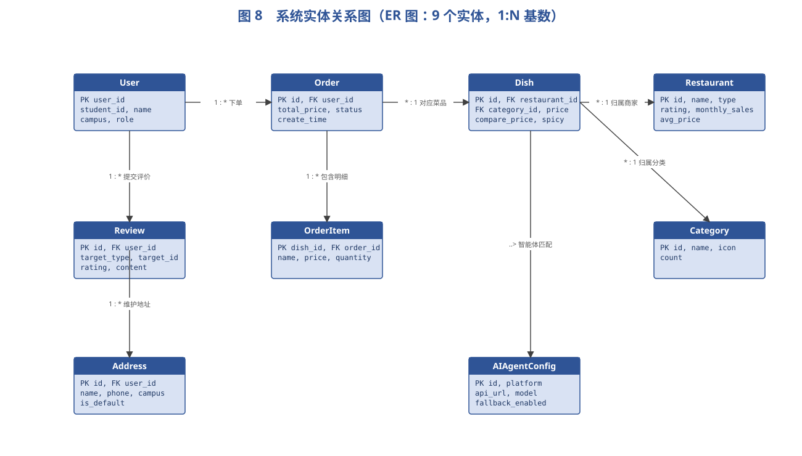

校园美食点餐平台

数据库设计说明书

| 项目 | 内容 |
| --- | --- |
| 课程名称 | 软件工程 |
| 团队名称 | 码上同行 |
| 团队成员 | 3124004437 唐嘉璇（队长）；3124004431 林鸿永；3124004450 曾堉源 |
| 项目名称 | 校园美食点餐平台（微信小程序） |
| 文档版本 | V1.0 |
| 编写日期 | 2026-11-22 |
| 文档依据 | GB/T 8567-2006《计算机软件文档编制规范》数据库设计说明书（DBDD） |

# 引言

## 编写目的

本文档描述校园美食点餐平台数据库的概念结构、逻辑结构与物理结构设计，定义全部实体、关系、表结构、字段约束与对象关系映射，作为后续数据库建立、数据访问层编码与测试的依据。本文档面向课程教师、助教、评审同学及团队内部成员。

## 背景

项目以微信小程序整合校园食堂窗口、周边商铺与路边小摊的菜品信息，提供 AI 选餐、跨平台比价、榜单、评价与下单功能。支撑这些功能的数据包括用户、商家、菜品、分类、订单、明细、评价、地址与智能体配置九类实体。课程原型阶段数据以本地 Mock 与缓存实现，结构上按真实点餐平台设计，便于后续迁移到关系数据库。

## 定义与缩写

下列缩写与术语在本文档中统一使用：

| 缩写 / 术语 | 定义 |
| --- | --- |
| DBDD | 数据库设计说明书（Database Design Document），本文档 |
| ER 图 | 实体—关系图（Entity-Relationship Diagram），描述实体、属性与联系 |
| PK | 主键（Primary Key），唯一标识一条记录 |
| FK | 外键（Foreign Key），引用另一张表的主键 |
| 3NF | 第三范式，关系模式消除非主属性对码的传递依赖 |
| ORM | 对象关系映射，实体类与库表之间的对应关系 |
| Mock | 本地示例数据层，课程原型阶段替代真实数据库 |
| comparePrice | 其他平台参考价，与本店价 price 比较得出省钱幅度 |
| 省钱幅度 | comparePrice − price，用于划算榜排序与省钱标签 |
| items_json | 订单明细的序列化存储字段，展示层解析为多个 OrderItem |
| 用户隔离 | 按用户 ID 过滤数据，保证不同用户数据互不可见 |

## 参考资料

（1）GB/T 8567-2006《计算机软件文档编制规范》。

（2）GB/T 9385《计算机软件需求规格说明规范》。

（3）《校园美食点餐平台软件需求分析说明书》与《系统设计说明书》。

（4）微信小程序官方开发文档（本地缓存与存储能力）。

# 外部设计

## 标识符和状态

课程原型阶段数据库以本地 Mock 数据集合形式存在，逻辑库名可标识为 campus_food_db，含 9 个实体集合：User、Restaurant、Dish、Category、Order、OrderItem、Review、Address、AIAgentConfig。数据处于“演示样本”状态，均为团队整理的示例数据；本机新增评价、购物车与登录态写入本地缓存。

## 使用它的程序

| 程序 / 模块 | 使用方式 |
| --- | --- |
| 小程序页面（P1–P12） | 经适配层读取与展示实体数据，提交表单写入缓存 |
| 接口适配层 utils/api.js | 统一封装对数据集合的增删改查，返回 Promise |
| 能力层 AIAgent | 读取本地菜品库匹配智能体推荐结果 |
| 比价与榜单模块 | 读取 Dish 三价字段计算省钱幅度并排序 |
| 订单模块 | 写入 Order 与 OrderItem，读取地址与商品明细 |

## 约定

（1）主键：实体主键统一命名为 id 或 <实体>Id，字符串型或自增；外键以关联实体主键命名并加 FK 标注。（2）命名：字段采用小驼峰（如 monthlySales、comparePrice）。（3）状态字段：订单 status 取值 pending / making / ready / done / cancel；商家 is_open 与地址 is_default 为布尔。（4）时间字段统一以字符串存储 ISO 格式。（5）金额以浮点数存储，展示时保留 1–2 位小数。

## 专用指导

省钱幅度不单独设存储字段，统一由 comparePrice − price 实时计算，保证展示与排序口径一致；订单明细采用 items_json 聚合存储，读取时解析为 OrderItem 对象列表；用户相关查询一律按 userId 过滤，实现用户隔离。

## 权限设计

用户仅能读取商家与菜品公开数据，写入评价、地址、订单等数据时绑定自身 userId；管理员经后台可维护商家菜品、查看与管理订单评价、配置智能体。演示密钥不进入前端正式包，用户不接触他人数据。

# 结构设计

## 概念结构设计

概念模型采用 ER 方法，识别 9 个实体及联系：User 与 Order 为一对多（一名用户多个订单）；Order 与 OrderItem 为一对多（一个订单多条明细）；OrderItem 与 Dish 为多对一（明细对应菜品）；Restaurant 与 Dish 为一对多（一家商家多道菜）；Category 与 Dish 为一对多（一个分类多道菜）；User 与 Review、User 与 Address 均为一对多；AIAgent 与 Dish 为匹配依赖，并通过适配层调用方舟大模型。ER 图如图 8。

图 8　系统实体关系图（ER 图）

| 联系 | 基数 | 说明 |
| --- | --- | --- |
| User—Order | 1 : * | 一名用户可下多个订单 |
| Order—OrderItem | 1 : * | 一个订单含多条菜品明细 |
| OrderItem—Dish | * : 1 | 每条明细对应一道菜品 |
| Restaurant—Dish | 1 : * | 一家商家上架多道菜品 |
| Category—Dish | 1 : * | 一个分类包含多道菜品 |
| User—Review | 1 : * | 一名用户可提交多条评价 |
| User—Address | 1 : * | 一名用户可维护多个地址 |
| AIAgent··>Dish | 依赖 | 智能体匹配本地菜品生成推荐 |
| AIAgent··>方舟 | 依赖 | 经适配层调用大模型接口 |

## 逻辑结构设计

将 ER 模型转换为如下关系模式（PK 主键，FK 外键），全部满足第三范式：

User(user_id, student_id, name, avatar, campus, role)

Restaurant(id, name, type, rating, monthly_sales, delivery_time, delivery_fee, min_order, avg_price, review_count, tags, notice, is_open)

Dish(id, name, price, original_price, compare_price, image, description, category_id FK, restaurant_id FK, sales, stock, review_count, tags, spec, spicy)

Category(id, name, icon, count)

Review(id, target_type, target_id, user_id FK, user_name, rating, content, time, likes)

Address(id, user_id FK, name, phone, campus, building, room, detail, is_default)

Order(id, user_id FK, items_json, total_price, status, create_time, restaurant_name, address, remark)

OrderItem(dish_id FK, order_id FK, name, price, quantity, image)

AIAgentConfig(id, enabled, platform, api_url, model, max_recommend, fallback_enabled)

## 物理结构设计

课程原型阶段以 JavaScript 对象数组实现数据集合，按实体分文件组织（如 mock.js），通过适配层访问；订单明细以 items_json 字符串字段存储于 Order 内，读取时解析。正式上线迁移至关系数据库后，为每个表建立主键索引，并为高频查询字段建立普通索引，如下表所示。

| 表 | 索引字段 | 用途 |
| --- | --- | --- |
| Dish | category_id, restaurant_id | 分类浏览、商家菜品查询 |
| Restaurant | type | 商家类型筛选 |
| Order | user_id, create_time | 我的订单、按时间排序 |
| Review | target_type, target_id | 按商家/菜品查评价 |
| Address | user_id | 用户地址列表 |
| OrderItem | order_id | 订单明细查询 |

# 数据表结构

## 用户表 User

| 字段名 | 类型 | 约束 | 说明 |
| --- | --- | --- | --- |
| user_id | string | PK | 用户唯一标识 |
| student_id | string | 唯一 | 学号/工号，登录账号 |
| name | string | 非空 | 用户姓名 |
| avatar | string |  | 头像地址 |
| campus | string |  | 所在校区 |
| role | string |  | 角色：user / admin |

## 商家表 Restaurant

| 字段名 | 类型 | 约束 | 说明 |
| --- | --- | --- | --- |
| id | string | PK | 商家唯一标识 |
| name | string | 非空 | 商家名称 |
| type | string |  | 类型：食堂/商铺/小摊 |
| rating | float |  | 评分 |
| monthly_sales | int |  | 月销量，热销榜依据 |
| delivery_time | int |  | 配送时长（分钟） |
| delivery_fee | float |  | 配送费 |
| min_order | float |  | 起送价 |
| avg_price | float |  | 人均价格 |
| review_count | int |  | 评价数 |
| tags | string |  | 标签（逗号分隔） |
| notice | string |  | 商家公告 |
| is_open | bool |  | 是否营业 |

## 菜品表 Dish

| 字段名 | 类型 | 约束 | 说明 |
| --- | --- | --- | --- |
| id | string | PK | 菜品唯一标识 |
| name | string | 非空 | 菜品名称 |
| price | float | 非空 | 本店售价 |
| original_price | float |  | 划线原价 |
| compare_price | float |  | 其他平台参考价 |
| image | string |  | 菜品图片地址 |
| description | string |  | 菜品描述 |
| category_id | string | FK | 所属分类 |
| restaurant_id | string | FK | 所属商家 |
| sales | int |  | 销量 |
| stock | int |  | 库存 |
| review_count | int |  | 评价数 |
| tags | string |  | 标签 |
| spec | string |  | 可选规格 |
| spicy | string |  | 辣度 |

## 分类表 Category

| 字段名 | 类型 | 约束 | 说明 |
| --- | --- | --- | --- |
| id | string | PK | 分类唯一标识 |
| name | string | 非空 | 分类名称 |
| icon | string |  | 分类图标 |
| count | int |  | 菜品数量 |

## 订单表 Order

| 字段名 | 类型 | 约束 | 说明 |
| --- | --- | --- | --- |
| id | string | PK | 订单唯一标识 |
| user_id | string | FK | 下单用户 |
| items_json | string |  | 菜品明细（序列化） |
| total_price | float | 非空 | 订单总价 |
| status | string |  | 状态：pending/making/ready/done/cancel |
| create_time | string |  | 下单时间 |
| restaurant_name | string |  | 商家名称快照 |
| address | string |  | 收货地址快照 |
| remark | string |  | 备注 |

## 订单明细表 OrderItem

| 字段名 | 类型 | 约束 | 说明 |
| --- | --- | --- | --- |
| dish_id | string | FK | 菜品标识 |
| order_id | string | FK | 所属订单 |
| name | string |  | 菜品名称快照 |
| price | float |  | 成交单价 |
| quantity | int |  | 数量 |
| image | string |  | 菜品图片 |

## 评价表 Review

| 字段名 | 类型 | 约束 | 说明 |
| --- | --- | --- | --- |
| id | string | PK | 评价唯一标识 |
| target_type | string |  | 目标类型：restaurant/dish |
| target_id | string |  | 目标对象标识 |
| user_id | string | FK | 评价用户 |
| user_name | string |  | 用户昵称快照 |
| rating | int |  | 评分 1–5 |
| content | string |  | 评价内容 |
| time | string |  | 评价时间 |
| likes | int |  | 点赞数 |

## 地址表 Address

| 字段名 | 类型 | 约束 | 说明 |
| --- | --- | --- | --- |
| id | string | PK | 地址唯一标识 |
| user_id | string | FK | 所属用户 |
| name | string |  | 收货人 |
| phone | string |  | 联系电话 |
| campus | string |  | 校区 |
| building | string |  | 楼栋 |
| room | string |  | 房间号 |
| detail | string |  | 详细地址 |
| is_default | bool |  | 是否默认地址 |

## 智能体配置表 AIAgentConfig

| 字段名 | 类型 | 约束 | 说明 |
| --- | --- | --- | --- |
| id | string | PK | 配置标识 |
| enabled | bool |  | 是否启用智能体 |
| platform | string |  | 大模型平台（火山方舟等） |
| api_url | string |  | 接口地址 |
| model | string |  | 模型名称 |
| max_recommend | int |  | 最大推荐菜品数 |
| fallback_enabled | bool |  | 本地兜底开关 |

# 对象关系映射（ORM）

实体类与库表一一对应，类名对应表名，对象属性对应字段。ORM 设计有两个关键点：

其一，“比价字段同源”。Dish 的 price、original_price、compare_price 三个字段共同支撑省钱标签与划算榜：省钱幅度 = compare_price − price，卡片展示与榜单排序共用同一口径，避免 UI 与排序不一致。

其二，“订单明细聚合映射”。Order.items_json 在展示层解析为多个 OrderItem 对象，写回时序列化存储，既保留关系模型的清晰，又适配本地 Mock 的存储形态。

| 实体类 | 对应表 | 映射要点 |
| --- | --- | --- |
| User | User | 属性一一对应，role 区分用户/管理员 |
| Restaurant | Restaurant | tags 字符串解析为标签数组 |
| Dish | Dish | 三价字段同源支撑比价 |
| Category | Category | count 缓存分类菜品数 |
| Order | Order | items_json 与 OrderItem 列表互转 |
| OrderItem | OrderItem | dish_id/order_id 外键引用 |
| Review | Review | target_type+target_id 多态关联 |
| Address | Address | user_id 隔离，is_default 标记默认 |
| AIAgentConfig | AIAgentConfig | fallback_enabled 控制兜底链路 |

# 数据字典

## 主要数据项

| 数据项 | 类型 | 取值范围 / 说明 |
| --- | --- | --- |
| role | string | user（普通用户）/ admin（管理员） |
| type（商家） | string | canteen（食堂）/ shop（商铺）/ stall（小摊） |
| spicy | string | 不辣 / 微辣 / 中辣 / 特辣 |
| status（订单） | string | pending / making / ready / done / cancel |
| target_type（评价） | string | restaurant / dish |
| rating | int | 1–5 |
| is_open / is_default / enabled / fallback_enabled | bool | true / false |
| price / compare_price / total_price | float | ≥ 0，展示保留 1–2 位小数 |

## 数据结构

数据结构以实体为单位组织，页面视图模型由实体字段映射而来：菜品视图 = Dish 字段 + 计算字段（省钱幅度、省钱标签）；订单视图 = Order + OrderItem 列表 + 地址快照；对话卡片视图 = Dish 摘要 + 来源标记（大模型/本地兜底）。

# 安全与一致性设计

## 用户隔离

评价、地址、订单等含用户归属的数据均以 user_id 过滤，用户仅能查看与修改自身数据；管理员操作需角色校验。

## 数据一致性

下单时 Order 的 items_json 与各 OrderItem 的 order_id 保持一致；评价提交后同步刷新目标对象的评价数与评分展示；比价数据由后台统一维护，避免同一菜品多处价格不一致。本地缓存写入采用先校验后写入，防止脏数据。

## 隐私与边界

演示密钥不进入前端正式包；不采集身份证等与功能无关的敏感信息；评价与比价均为课程演示样本，不代表真实平台数据。正式上线后补充数据库备份、访问审计与敏感字段加密。
